<div align="center">



<br/>

<a href="https://github.com/FirstKhoi">
  
</a>

<br/><br/>


<a href="https://github.com/FirstKhoi?tab=followers"></a>
<a href="https://www.linkedin.com/in/luong-nhat-khoi/"></a>
<a href="mailto:luongnhatkhoi2803@gmail.com"></a>

</div>

---

## `⚡ whoami`

```python
from dataclasses import dataclass, field


@dataclass(frozen=True)
class FirstKhoi:
    """Baselines before benchmarks. Ablations before claims."""

    name:   str = "Luong Nhat Khoi"
    handle: str = "FirstKhoi"
    origin: str = "Vietnam 🇻🇳"
    status: str = "CS / Data Science · undergraduate"

    goal:   str = "Research-grade computer vision, built from first principles."

    focus: list[str] = field(default_factory=lambda: [
        "Computer Vision  → detection, tracking, spatial reasoning",
        "Deep Learning    → CNN internals, optimization, ablations",
        "Classical ML     → boosting theory, interpretability",
        "Research craft   → baselines, ablations, reproducibility",
    ])

    principle: str = "Depth over breadth. One question, answered properly."

    def why(self) -> str:
        return "A result I cannot reproduce is a result I do not have."
```

---

## `🛠 tech_stack`

<div align="center">


**Vision** · `YOLOv8` `MOG2` `Optical Flow`<br/>
**Learning** · `CNN` `ResNet` `XGBoost` `LightGBM` `TreeSHAP`

</div>

---

## `📦 featured_work`

<table>
<tr>
<td width="33%" valign="top">

### [⚽ Football Analysis](https://github.com/FirstKhoi/Football_Analysis)
`YOLO26` `ByteTrack` `Optical Flow`

Football video analysis: detects and tracks players, referees and the ball, splits teams by jersey colour, and measures each player's position in meters, speed and distance run.

</td>
<td width="33%" valign="top">

### [🏛 All CNN U Need](https://github.com/FirstKhoi/all_cnn_u_need)
`PyTorch` `CIFAR-10`

Classic CNNs re-implemented in chronological order, LeNet to ConvNeXt, each trained on CIFAR-10 to see what it improves over the last.

</td>
<td width="33%" valign="top">

### [✍️ Handwritten Digit Recognition](https://github.com/FirstKhoi/handwritten-digit-recognition)
`PyTorch` `ONNX` `Flask`

LeNet-5 on MNIST: a 6-architecture ablation, an out-of-distribution reject class, digit-sequence reading, and a web app running in the browser.

</td>
</tr>
</table>

---

## `📈 current_training_run`

```console
$ python -m notworle.train --track research-portfolio --epochs inf

  epoch  track                 metric              status
  ─────  ────────────────────  ──────────────────  ──────────────────────────
   01    classical-cv          ghost_tracks 4→2    ✔ MOG2 validated
   02    cnn-foundations       lenet5 debugged     ✔ forward() bug fixed
   03    ensembles             rf · adaboost       ✔ derived by hand
   04    boosting-theory       xgboost newton      ▶ in progress
   05    cnn-ablation          mnist → cifar10     ▶ in progress
   06    indoor-localization   leakage-safe split  ○ queued
   07    mot-benchmark         mota · idf1         ○ queued
   08    paper-reproduction    cvpr / iccv         ○ queued

  early_stopping = None          # patience: unlimited
  ⚠  watchlist: frame-level data leakage in video splits
```

---

## `📡 live_signal`

> Not narrative — pulled straight from the GitHub API on a schedule. If this block is stale, the pipeline broke, not the story.

<!-- LIVE_SIGNAL:START -->
```console
$ python -m notworle.stats --source github --live

  metric                        value       updated (UTC)
  ─────────────────────────────  ──────────  ────────────────────
  current_streak_days             65          2026-11-16 05:37
  contributions_this_week         38
  repos_touched_7d                3
  last_active_at                  2026-11-16

  source: github graphql api · auto-regenerated every 12h
```
<!-- LIVE_SIGNAL:END -->

---

## `📊 stats`

<div align="center">


</div>

---

## `🐍 contribution_graph`

<div align="center">

<picture>
  <source media="(prefers-color-scheme: dark)" srcset="https://raw.githubusercontent.com/FirstKhoi/FirstKhoi/output/github-snake-dark.svg" />
  <source media="(prefers-color-scheme: light)" srcset="https://raw.githubusercontent.com/FirstKhoi/FirstKhoi/output/github-snake.svg" />
  
</picture>

</div>

---

## `🧊 isocalendar_3d`

<div align="center">


</div>

---

<div align="center">


</div>
